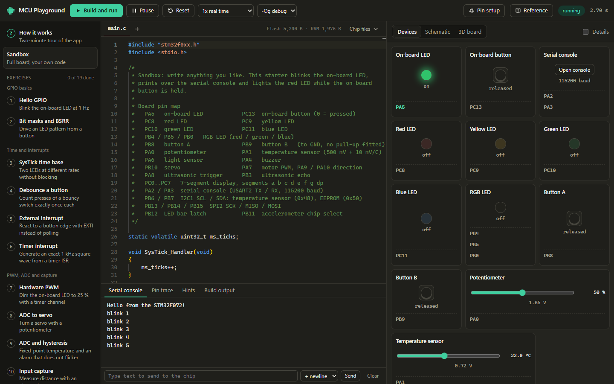
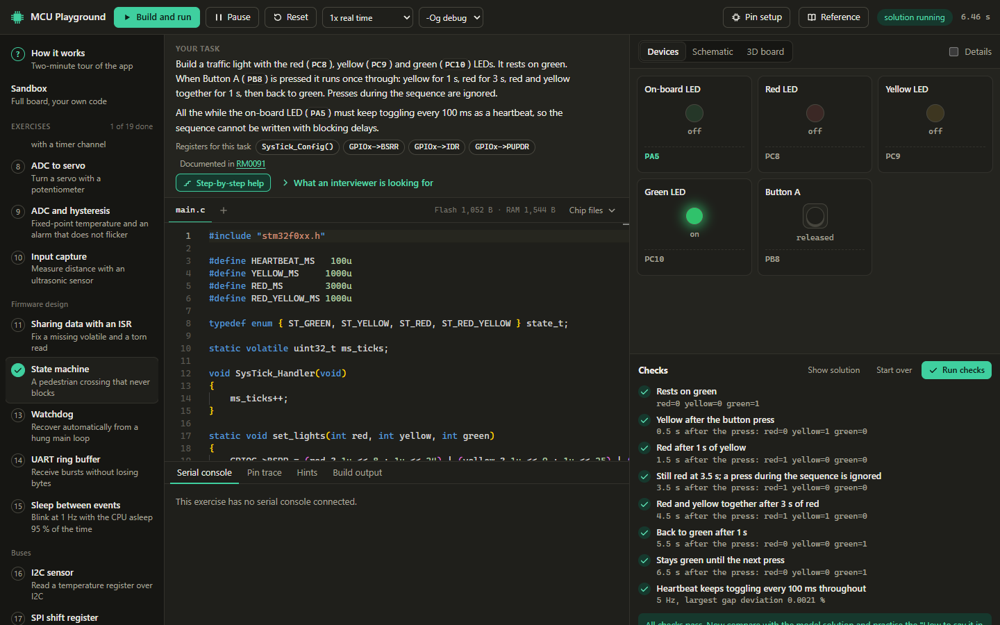
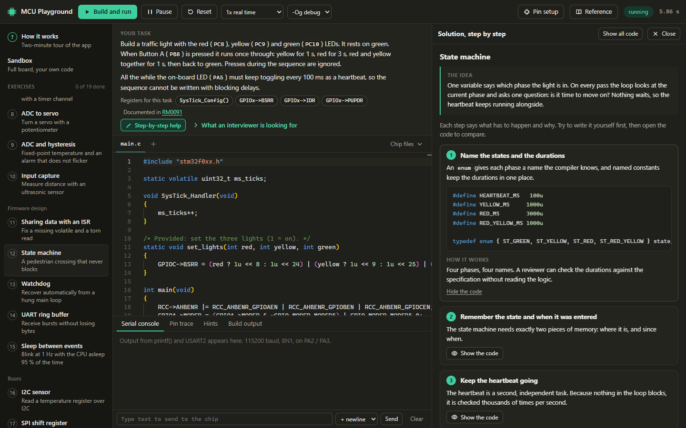
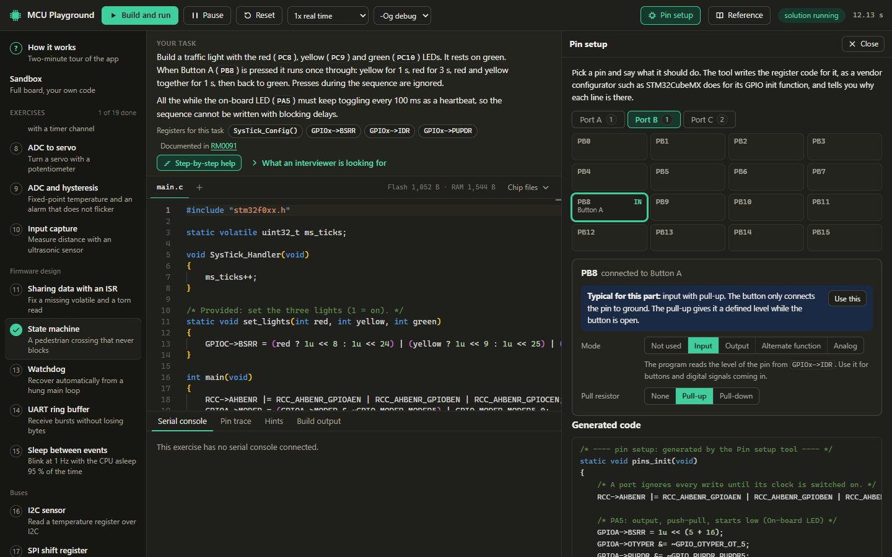
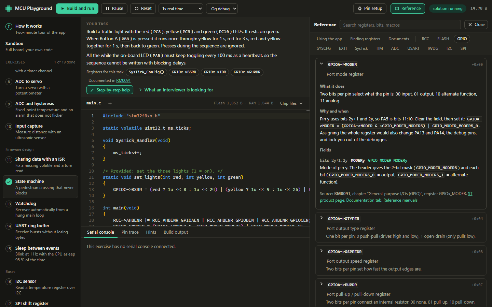
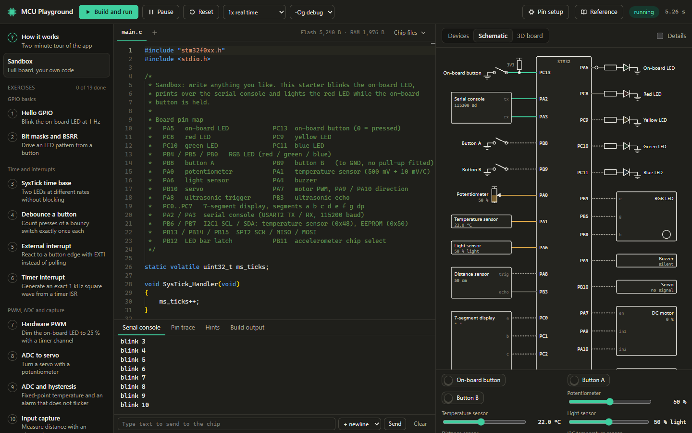

# MCU Playground

Practise embedded C on a simulated microcontroller, in your browser.

You write register-level C for an STM32F072 (ARM Cortex-M0). It is compiled with the
real `arm-none-eabi-gcc`, and the firmware runs instruction by instruction on an
emulated chip wired to a virtual board with LEDs, buttons, sensors, a servo, a motor
and I2C and SPI devices. Nineteen exercises with automatic checks and explained model
solutions cover the topics that embedded interviews ask about.



## Contents

- [What you get](#what-you-get)
- [Getting started](#getting-started)
- [Using the playground](#using-the-playground)
- [The exercises](#the-exercises)
- [The board](#the-board)
- [What is simulated](#what-is-simulated)
- [How it works](#how-it-works)
- [Development](#development)
- [Licences and trademarks](#licences-and-trademarks)

## What you get

**Real code on a real instruction set.** The emulator implements the complete ARMv6-M
instruction set with cycle counts, interrupts and the peripherals at register level.
The code uses ST's official device header, so `RCC->AHBENR |= RCC_AHBENR_GPIOAEN;`
is exactly what you would write for the real part.

**Exercises that check themselves.** Each exercise runs your firmware on a fresh board,
presses buttons and sets sensor values by script, and measures what the pins do.
A failed check tells you what it measured.



**Model solutions that explain themselves.** Step-by-step help lists what has to happen
and why. The code of each step stays folded until you ask for it, so you can take one
hint at a time. Every solution ends with the common mistakes and a short answer you
can say out loud in an interview. You can also run the model solution on the board.



**A pin setup tool.** Choose a mode for each pin and get the register code for it,
as a vendor configurator such as STM32CubeMX generates its GPIO init function. The
tool knows what is wired to each pin, suggests a fitting setting and says why.



**A built-in reference.** Every simulated register bit by bit, with what it does, why
and when you touch it, and the document and chapter it comes from. Hover a register
in the editor, press F1 on it, or type `RCC->` for a list.



**Three views of the same circuit.** Friendly device tiles, a live schematic whose
wires are coloured by their state, and a 3D board.



**Hints for silent failures.** A peripheral without a clock, a floating input, an
interrupt flag that is never cleared: real hardware does nothing and says nothing.
The simulator explains what happened and points at the line. HardFaults are explained
in the same way.

## Getting started

You need:

- [Node.js](https://nodejs.org) 22 or newer (developed with Node 24)
- About 1.5 GB of free disk space for the ARM compiler
- A current Chrome, Edge or Firefox

Clone the repository, then, in its folder, install the dependencies:

```bash
npm install
```

Download the ARM compiler. This is needed once and takes a few minutes:

```bash
npm run toolchain
```

Start the playground:

```bash
npm run dev
```

Open the address that the last command prints, normally http://127.0.0.1:5183.

`npm run toolchain` installs the [xPack GNU Arm Embedded GCC](https://xpack-dev-tools.github.io/arm-none-eabi-gcc-xpack/)
into a per-user folder and links it into `xpacks/`. Nothing is installed system-wide.

The project was developed and tested on Windows 11. The compiler package also exists
for macOS and Linux, but the playground has not been tested there yet.

There is no hosted version: the compiler runs on your own machine, behind a small
local API. That API listens on `127.0.0.1` only. Do not expose it to a network, because
it compiles whatever source it is sent.

## Using the playground

The app opens a two-minute tour on the first visit. You can reopen it at any time
with **How it works** at the top of the exercise list. In short:

1. **Pick an exercise** on the left. They go from easy to hard; start with *Hello GPIO*.
   The *Sandbox* has the full board and no task.
2. **Read the task** above the editor. The chips under it are the registers you need.
   Click one to see what it does.
3. **Write the code.** The starter marks every gap with a `TODO`.
4. **Build and run** (Ctrl+Enter). The board comes alive. Click its buttons and move
   its sliders to feed inputs to your program.
5. **Run checks** to have your program measured.
6. **Stuck?** Open *Step-by-step help*. It gives the reason for each step and keeps the
   code folded until you open it. *Show solution* opens everything.
7. **Be able to say it.** Read the common mistakes and the spoken answer at the end of
   each solution.

Other things worth knowing:

| Control | What it does |
|---|---|
| Speed | Slow motion to watch fast signals, or as fast as possible. |
| Optimise | The compiler optimisation level. `-O2` is what release builds use and exposes bugs such as a missing `volatile`. |
| Pin trace | Pins over time, like a logic analyser, with frequency and duty cycle. Click a wire in the schematic to add its pin. |
| Hints | Why something silently does nothing. |
| Chip files | The start-up code, linker script and device header that are compiled with your code. |

Your code is saved automatically to `workspace/<exercise>/` on disk. That folder is
ignored by git.

## The exercises

| # | Exercise | What you practise |
|---|---|---|
| 1 | Hello GPIO | Clock gating, pin modes, toggling a pin |
| 2 | Bit masks and BSRR | Setting, clearing and testing bits; atomic port writes |
| 3 | SysTick time base | A 1 ms tick and non-blocking timing |
| 4 | Debounce a button | Pull-ups, sampling, counting on transitions |
| 5 | External interrupt | SYSCFG, EXTI, NVIC, clearing a pending flag |
| 6 | Timer interrupt | Prescaler and auto-reload arithmetic, update interrupts |
| 7 | Hardware PWM | Alternate functions, PWM mode, duty cycle |
| 8 | ADC to servo | ADC start-up sequence, integer scaling |
| 9 | ADC and hysteresis | Fixed-point conversion, two thresholds |
| 10 | Input capture | Timestamping edges in hardware, timeouts |
| 11 | Sharing data with an ISR | `volatile`, torn reads, critical sections (built with `-O2`) |
| 12 | State machine | States, transitions, timing without blocking |
| 13 | Watchdog | IWDG key sequence, where to kick, reset cause |
| 14 | UART ring buffer | Receive interrupt, single-producer single-consumer buffer |
| 15 | Sleep between events | `WFI`, letting a timer do the waiting |
| 16 | I2C sensor | Open-drain pins, repeated START, NACK handling |
| 17 | SPI shift register | SPI master set-up and its classic traps, latching |
| 18 | SPI accelerometer | Chip-select framing, burst reads, signed conversion |
| 19 | C drills | Bit tricks and a ring buffer, the whiteboard classics |

## The board

| Pin | Device | Pin | Device |
|---|---|---|---|
| PA5 | on-board LED | PC13 | on-board button (0 = pressed, pull-up fitted) |
| PC8 / PC9 / PC10 / PC11 | red / yellow / green / blue LED | PB4 / PB5 / PB0 | RGB LED (R / G / B) |
| PB8 / PB9 | button A / B (to GND, no pull-up fitted) | PA0 | potentiometer |
| PA1 | temperature sensor (500 mV + 10 mV/°C) | PA6 | light sensor |
| PA4 | buzzer | PB10 | servo |
| PA7, PA9, PA10 | motor PWM, direction 1, direction 2 | PA8 / PB3 | ultrasonic trigger / echo |
| PC0..PC7 | 7-segment a b c d e f g dp | PA2 / PA3 | serial console TX / RX (115200) |
| PB6 / PB7 | I2C1 SCL / SDA: temperature sensor (0x48), EEPROM (0x50) | PB13 / PB14 / PB15 | SPI2 SCK / MISO / MOSI |
| PB12 | LED bar latch (74HC595) | PB11 | accelerometer chip select |

The on-board LED and button are where the Nucleo-F072RB has them. The other parts are
the playground's own and do not match a commercial board.

## What is simulated

**CPU.** The complete ARMv6-M instruction set with Cortex-M0 cycle counts, exceptions,
NVIC priorities, PendSV and SVC, SysTick, `WFI` sleep, and HardFault including
unaligned access. Simulated time is cycles divided by the clock frequency, so delays,
baud rates and PWM are timing-accurate.

**Peripherals, at register level.** RCC (clock gating, HSI, HSI48, PLL), GPIO A to D
and F, SYSCFG and EXTI, TIM2, TIM3, TIM14, TIM6 and TIM7 (up-counting, PWM, output
compare, input capture, one-pulse), ADC, USART2, IWDG, I2C1 as master and SPI2 as
master, with bit-accurate waveforms on the bus pins.

**Not simulated.** SPI1, I2C2, I2C and SPI slave mode, DMA, USB, CAN, RTC, TIM1 and
TIM15 to TIM17, down-counting and encoder timer modes, Stop and Standby. Touching one
of these gives a hint, not a crash.

**Limits you should know about.** This is a functional model, not a model of the
silicon. Analog behaviour is idealised, the oscillators have no tolerance, and
electrical effects such as output drive strength do not exist. Code that passes here
is correct at register level; it has not been proven on hardware.

## How it works

```
Browser
  Editor ── Build ──► POST /api/compile ──► arm-none-eabi-gcc  (local dev-server middleware)
     ▲                                          │ ELF, diagnostics
     │                                          ▼
  Board views ◄── pin, UART and trace frames ── Web Worker: CPU + bus + peripherals + devices
              ── button presses, sliders ──►
```

- The emulator core is plain TypeScript with no browser dependency. The same code runs
  in the worker, in the tests and in the headless exercise checker.
- The compile API is a Vite dev-server middleware, so `npm run dev` is the only process.
- Exercises are checked headlessly: a script drives the board and asserts on pin
  traces, serial output or firmware variables.

## Development

```bash
npm test
```

```bash
npm run build
```

`npm test` needs the toolchain, because most tests compile real firmware.

| Test file | What it proves |
|---|---|
| `cpu-diff` | The same C programs (CRC, 64-bit math, soft-float, sorting, `setjmp`, `malloc`) give identical output natively and on the emulated chip, at four optimisation levels. Needs a host `gcc`; skipped without one. |
| `cpu-flags` | 64,000 single-instruction cases against an independent model of the ARM pseudo-code. |
| `peripherals`, `buses` | Behaviour and timing of each peripheral, measured on the pins. |
| `exercises` | Every reference solution passes its checks at `-Og` and `-O2` without compiler warnings, and every unmodified starter fails. |
| `walkthroughs` | Every code passage quoted in an explained solution appears in the tested reference solution, and every register link resolves. |
| `reference` | Macro names, bit positions, field widths and register offsets in the reference match ST's header. |
| `pinconfig` | Code from the pin setup tool compiles without warnings and configures the simulated chip as requested. |
| `api` | The local compile and save API. |

### Project layout

```
firmware/        start-up code, linker script, syscalls, CMSIS headers
server/          arm-none-eabi-gcc wrapper used by the dev-server API and the tests
src/emu/         CPU core, bus, clock, ELF loader, peripherals
src/board/       nets, devices, board definition
src/exercises/   exercises, explained solutions, headless check runner
src/pinconfig/   code generator of the pin setup tool
src/reference/   register reference, guides, source documents
src/worker/      simulation worker
src/ui/          React user interface
tests/           test suite
docs/            screenshots
```

### Adding an exercise

1. Add an `Exercise` object to one of the `src/exercises/set*.ts` files: the task, the
   background, the registers it uses, the devices it needs, starter code, a reference
   solution and a `check()` function that drives the board and records results.
2. Add its explained solution to `src/exercises/explain*.ts`, quoting the solution's
   code step by step.
3. List it in `EXERCISES` and in one of the `GROUPS` in `src/exercises/index.ts`.
4. Run `npm test`. It builds the solution and the starter, runs the checks on both,
   and verifies that the explanation quotes code that exists.

## Licences and trademarks

The playground's own code is released under the [MIT License](LICENSE).

The files in `firmware/cmsis/` are the CMSIS core headers by Arm and the STM32F0 device
headers by STMicroelectronics, both under the Apache License 2.0. Their licence texts
are in `firmware/cmsis/LICENSE-ARM.txt` and `firmware/cmsis/LICENSE-ST.md`.

The reference texts in the app are summaries written for this project. They are not
excerpts from the manufacturers' documents, and where they disagree with a reference
manual or datasheet, the manufacturer's document is right.

STM32 is a trademark of STMicroelectronics. Arm and Cortex are trademarks of Arm
Limited. This project is not affiliated with or endorsed by either company.
